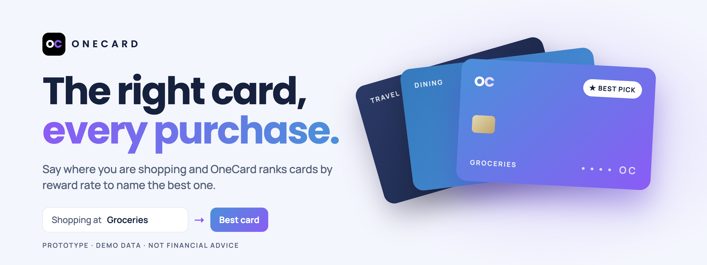
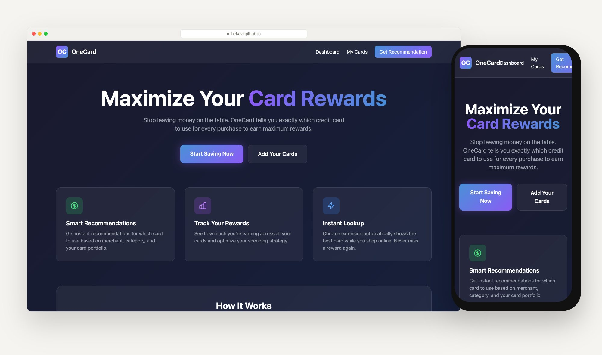
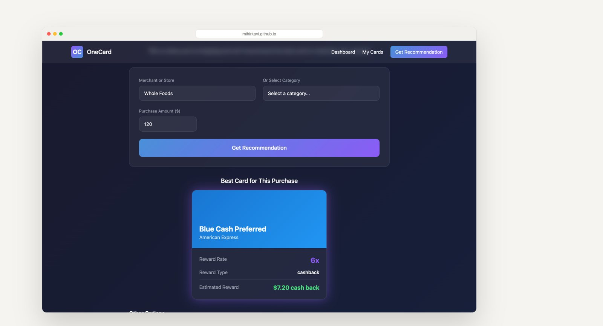
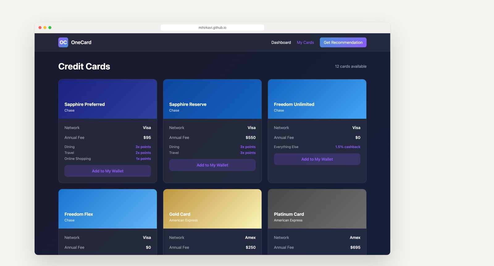
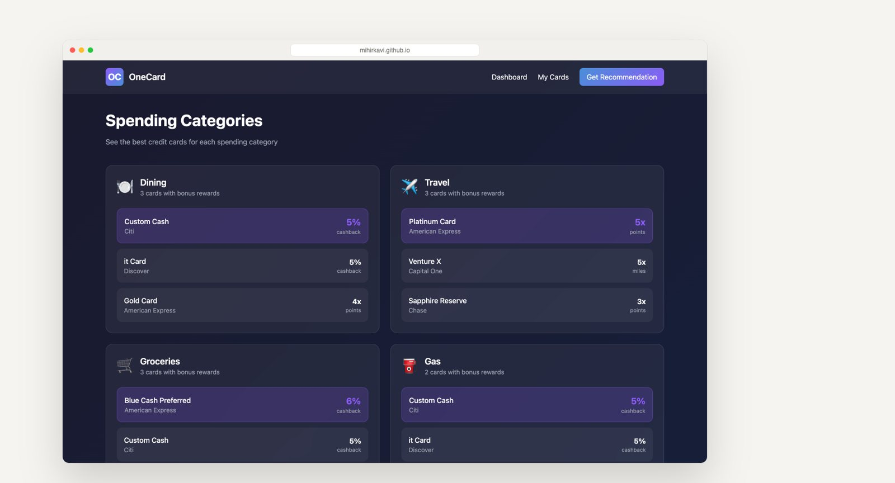
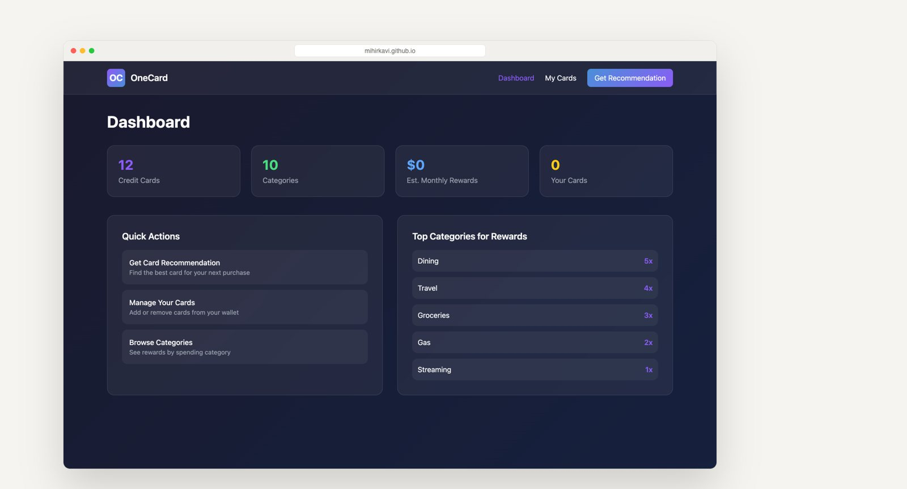
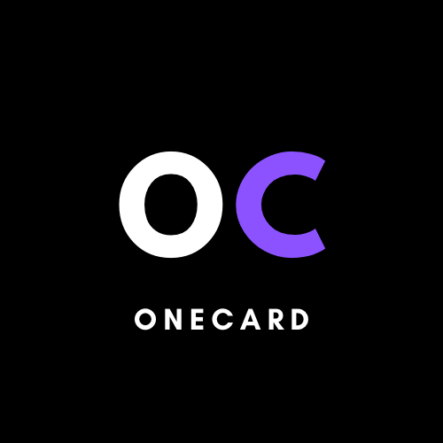

<p align="center">
  <a href="https://mihirkavi.github.io/OneCard/">
    <picture>
      <source media="(prefers-color-scheme: dark)" srcset=".github/assets/banner-dark.png">
      
    </picture>
  </a>
</p>

<p align="center">
  <strong>Stop guessing which card to swipe.</strong><br>
  OneCard is a credit-card rewards optimizer prototype: type a store or pick a category, and it compares reward rates to recommend the best card.
</p>

<p align="center">
  <a href="https://mihirkavi.github.io/OneCard/"><strong>Live demo</strong></a> ·
  <a href="#a-quick-tour"><strong>Tour</strong></a> ·
  <a href="#run-it-yourself"><strong>Run it</strong></a> ·
  <a href="#whats-in-the-box"><strong>What's in the box</strong></a> ·
  <a href="#honest-status"><strong>Honest status</strong></a>
</p>

<p align="center">
  
  
  <a href="https://github.com/mihirkavi/OneCard/actions/workflows/deploy.yml"></a>
  
</p>

<p align="center">
  
</p>

## Why OneCard

Most people carry several credit cards, each with its own bonus categories: 4x at restaurants on one, 6% on groceries on another, 5x on travel on a third. Remembering which card wins at the checkout is a puzzle, so most purchases go on whatever card is on top of the wallet, and the extra rewards are simply lost.

**OneCard does the remembering.** Enter a merchant such as Whole Foods or a category such as Dining, add the amount, and it ranks the cards by reward rate and estimates what you would earn. The same idea is sketched as a Chrome extension that suggests a card while you shop online, and as a pocket-sized mobile app.

<table>
  <tr>
    <td width="33%" valign="top">
      <h3>One answer, instantly</h3>
      Type a store or choose a category and get the best card, its reward rate and an estimated reward for the amount.
    </td>
    <td width="33%" valign="top">
      <h3>Every category, mapped</h3>
      Browse 12 popular cards and the top card for each of 10 spending categories, from groceries to streaming.
    </td>
    <td width="33%" valign="top">
      <h3>Wherever you shop</h3>
      A Chrome extension prototype shows a "best card" banner on known shopping sites; an Expo app prototype does the same on mobile.
    </td>
  </tr>
</table>

## A quick tour

<table>
  <tr>
    <td width="50%" valign="top">
      
      <h4>Get a recommendation</h4>
      Enter a merchant and amount; OneCard names the best card and estimates the reward.
    </td>
    <td width="50%" valign="top">
      
      <h4>Browse the cards</h4>
      Network, annual fee and bonus categories for each card in the demo set.
    </td>
  </tr>
  <tr>
    <td width="50%" valign="top">
      
      <h4>Best card by category</h4>
      The leading cards for each kind of spending, ranked by reward rate.
    </td>
    <td width="50%" valign="top">
      
      <h4>Dashboard</h4>
      A starting point for a personal rewards overview, with quick actions.
    </td>
  </tr>
</table>

<sub>Screenshots of the live GitHub Pages demo, captured with a headless browser. All cards and reward rates are static demo data, not live issuer terms.</sub>

## Run it yourself

**You need:** Node.js 20 and npm.

```bash
git clone https://github.com/mihirkavi/OneCard.git
cd OneCard
npm install
npm run dev
```

Open <http://localhost:5000>. The app reads its cards and reward rules from [`lib/static-data.ts`](lib/static-data.ts), so no database is needed.

| Command | What it does |
| --- | --- |
| `npm run dev` | Start the web app on port 5000 |
| `npm run build` | Production build |
| `npm run build:github` | Static export to `out/` for GitHub Pages ([`scripts/build-github.sh`](scripts/build-github.sh)) |

Every push to `main` rebuilds and deploys the live demo through [`.github/workflows/deploy.yml`](.github/workflows/deploy.yml).

## What's in the box

| Part | Where | Status |
| --- | --- | --- |
| **Web app**: home, recommendation form, cards, categories, dashboard | `app/` | ✅ Works with demo data |
| **Recommendation API**: `GET /api/recommend?merchant=…&category=…&amount=…` | `app/api/recommend` | ✅ Local server only (not in the static Pages build) |
| **Chrome extension** (Manifest V3): banner with the best card on about 20 known shopping sites | `apps/extension` | 🧪 Prototype |
| **Mobile app** (Expo / React Native): category lookup | `apps/mobile` | 🧪 Prototype |
| **Database schema** (Drizzle + PostgreSQL) and seed script | `lib/db`, `scripts/seed.ts` | 🔜 Not wired into the pages |
| **Personal wallet**: save your own cards and get picks only from them | `app/cards` | 🔜 Planned (button is a placeholder) |

<details>
<summary><strong>Venture materials in this repository</strong></summary>
<br>

OneCard started as a startup idea, and the repository keeps its planning work alongside the code: a business model canvas, financial models and seed-competition projections, a pitch deck and presentation, a web feasibility study, tech specs, a credit-card rewards list, logo and background artwork, and meeting notes and recordings.

</details>

## Honest status

OneCard is a **working prototype on demo data**, not a financial product.

- Cards, issuers and reward rates are a **hand-made sample of 12 cards** in `lib/static-data.ts`. They are not synced with issuers and may be out of date. Always check the issuer's current terms before deciding how to pay.
- Recommendations rank cards by the **raw reward number**, so points, miles and cash back are compared as if one point were worth one cent. Category caps, spending limits, rotating categories and annual fees are not modeled.
- There are **no accounts and no saved wallet**. "Add to My Wallet" and the "Your Cards" count are placeholders, so picks are made from the whole sample set rather than from cards you own.
- The Chrome extension uses its own built-in site list, references 16 px and 48 px icons that are not yet in the folder, and its "open app" link points to an old Replit address.
- The mobile app is an early single-screen prototype with hard-coded categories.
- OneCard never asks for card numbers or bank logins, and it is not financial advice.

<details>
<summary><strong>Notes for agents</strong></summary>
<br>

- The Pages workflow temporarily moves `app/api` aside and builds with `GITHUB_PAGES=true`, which turns on `output: 'export'` and the `/OneCard` base path in `next.config.js`.
- Older build output (`.next/`, `out/`) is committed in this repository; do not treat it as source.
- `replit.md` describes the original Replit setup and the planned database tables.

</details>

## License

No license file is included in this repository. This README grants no additional reuse or redistribution permissions; contact the repository owner about permitted use.

<p align="center">
  <br>
  <br>
  <sub><strong>OneCard</strong> · The right card, every purchase.</sub>
</p>
